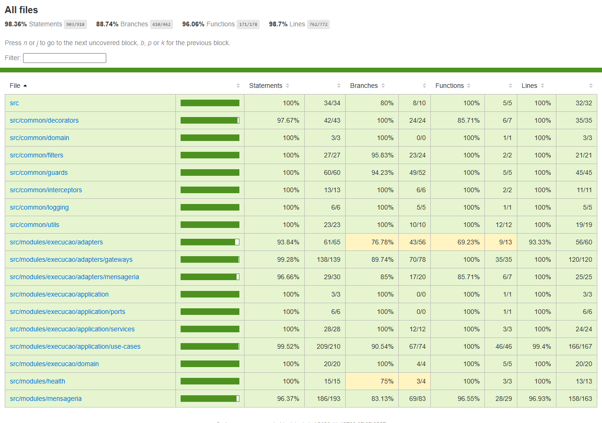

# tc-oficina-execution-service — Serviço de Execução (filas de diagnóstico e reparo)

[](https://github.com/FIAP-POS-TECH-SOFTWARE-ARCHITECTURE/tc-oficina-execution-service/actions/workflows/ci.yml)

Serviço de execução da oficina mecânica — Tech Challenge FIAP SOAT, Fase 4, grupo
**Integradores**. API REST NestJS em Clean Architecture, com banco PostgreSQL próprio, que mantém
as filas de **diagnóstico** e de **reparo** atendidas pelos mecânicos e participa da **Saga**
coordenada pelo `os-service`.

## Propósito ✱

Na Fase 4 o monólito da Fase 3 foi dividido em três microsserviços (`os-service`,
`billing-service`, `execution-service`), cada um com o seu banco. O `execution-service` é dono de:

- **filas de trabalho**: uma ordem de diagnóstico e uma de reparo por OS; a "fila" é a própria
  tabela `ordens_execucao`, e a próxima ordem é entregue ao mecânico com
  `SELECT ... FOR UPDATE SKIP LOCKED`, de modo que dois mecânicos nunca pegam a mesma;
- **execução**: registro do diagnóstico (com itens validados no catálogo do OS), rejeição,
  conclusão ou inviabilidade do reparo, acompanhamento de cada serviço e histórico de estados;
- **compensação**: cancela a ordem ativa quando o orquestrador desfaz o fluxo, inclusive quando o
  cancelamento chega antes da criação da ordem.

**Papel na Saga:** participante. O fluxo da OS segue o **Saga Pattern** na variante orquestrada:
quem decide o próximo passo e as compensações é o orquestrador, que fica no `os-service` (no
código, módulo `orquestracao-os`, com o estado em `FluxoOrdemServico` e o coordenador
`OrquestradorOrdemServico`). O execution não tem lógica de orquestração e não conhece o
`billing-service`: recebe comandos e publica eventos.

A aplicação roda atrás do **API Gateway HTTP API** (rotas com o prefixo `/execucao`) em dois
ambientes, `homolog` e `prod`, separados por namespace no EKS, e emite telemetria para o New
Relic (APM, logs estruturados e rastreamento distribuído entre os serviços).

## Tecnologias ✱

| Camada | Tecnologia |
| --- | --- |
| Runtime | Node.js 25 (imagem `node:25-alpine`) + TypeScript |
| Framework | NestJS 11 |
| Banco | PostgreSQL 18 (RDS em produção) — `oficina-execution-db` |
| ORM | Prisma 6 |
| Mensageria | Amazon SNS + SQS (AWS SDK v3), com outbox transacional e idempotência por `messageId` |
| Contratos | JSON Schema (Ajv) em [`contratos/`](contratos/README.md), validados na publicação e no consumo |
| Auth | JWT HS256 (`@nestjs/jwt`) + guard de papéis (`MECANICO`, `ADMINISTRADOR`) |
| Integração síncrona | REST interno ao catálogo do `os-service` (`x-internal-api-key`, timeout de 3 s, cache de 60 s) |
| Testes | Jest 30 + `jest-cucumber` (BDD) + Supertest + Testcontainers (Postgres) + MiniStack |
| Qualidade | SonarQube (quality gate com cobertura mínima de 80%) |
| Observabilidade | New Relic (APM + `nestjs-pino`) |
| Containers | Docker + Docker Compose |
| Orquestração | Kubernetes (EKS), Kustomize, HPA por CPU, rolling update |
| CI/CD | GitHub Actions |
| Emulador AWS local | MiniStack (SNS/SQS) |

## Arquitetura deste repositório ✱

Documento completo, com componentes, rotas, máquina de estados da ordem, modelo de dados, a fila
com `FOR UPDATE SKIP LOCKED`, cancelamento antecipado, mensagens/outbox e a consulta síncrona ao
catálogo: [`docs/arquitetura.md`](docs/arquitetura.md). Contratos das mensagens:
[`contratos/README.md`](contratos/README.md) (cópia de `tc-oficina-os-service/contratos`; o CI
confere que as duas estão sincronizadas).

Visão da solução e decisão da Saga, no `os-service`:
[visão geral dos microsserviços](https://github.com/FIAP-POS-TECH-SOFTWARE-ARCHITECTURE/tc-oficina-os-service/blob/main/docs/arquitetura/visao-geral-microsservicos.md) e
[ADR-008 (Saga orquestrada)](https://github.com/FIAP-POS-TECH-SOFTWARE-ARCHITECTURE/tc-oficina-os-service/blob/main/docs/arquitetura/adrs/adr-008-saga-orquestrada.md).

### Saga Pattern — participação do execution

| Passo da Saga | Comando que o execution recebe | Eventos que devolve |
| --- | --- | --- |
| Diagnosticar | `SolicitarDiagnostico` | `ExecucaoEnfileirada` na hora; depois `DiagnosticoIniciado` e `DiagnosticoConcluido` ou `DiagnosticoRejeitado`, conforme o mecânico |
| Reparar | `IniciarReparo` | `ExecucaoEnfileirada` na hora; depois `ReparoIniciado` e `ReparoConcluido` ou `ReparoInviavel` |
| Compensar: cancelar a execução | `CancelarExecucao` | `ExecucaoCancelada` (também quando não há ordem ativa) |

As ações humanas (pegar da fila, concluir, rejeitar) acontecem por HTTP e viram eventos que o
orquestrador consome. `ReparoInviavel` dispara a compensação completa no orquestrador (estorno do
pagamento, cancelamento do orçamento e estorno da reserva de estoque). A atribuição concorrente
da fila é resolvida na mesma transação com `SELECT ... FOR UPDATE SKIP LOCKED`. O consumo é idempotente por `messageId`
e `CancelarExecucao` que chega antes do comando de criação é registrado em `fluxos_cancelados`
(o SQS Standard não garante ordem).

## Comunicação ✱

### Assíncrona (SNS/SQS)

Os nomes físicos levam o prefixo `oficina-<env>-` (`homolog`, `prod`, ou `local` no emulador) e a
fila tem uma DLQ `-dlq` (redrive na 5ª entrega). Catálogo completo de mensagens, schemas e regras
de idempotência: [`contratos/README.md`](contratos/README.md).

| Sentido | Recurso | Tipos de mensagem |
| --- | --- | --- |
| Consome (comando) | fila `oficina-<env>-execucao-comandos` (aceita só `origem: os`) | `SolicitarDiagnostico`, `IniciarReparo`, `CancelarExecucao` |
| Produz (evento) | tópico SNS `oficina-<env>-eventos` (`origem: execution`) | `ExecucaoEnfileirada`, `DiagnosticoIniciado`, `DiagnosticoConcluido`, `DiagnosticoRejeitado`, `ReparoIniciado`, `ReparoConcluido`, `ReparoInviavel`, `ExecucaoCancelada` |

Os eventos saem pelo outbox (`outbox_mensagens`), gravado na mesma transação do efeito e
publicado por um relay a cada segundo, com `SKIP LOCKED` para réplicas diferentes não publicarem a
mesma mensagem.

### Síncrona (REST)

Todas as rotas `/execucao` exigem JWT de `MECANICO` ou `ADMINISTRADOR`; só o mecânico que pegou a
ordem (ou um administrador) age nela, e ordem cancelada pelo fluxo recusa qualquer ação com `422`.

| Rota | Função |
| --- | --- |
| `GET /execucao/fila?etapa=DIAGNOSTICO\|REPARO` | ordens `PENDENTE` em ordem de chegada |
| `POST /execucao/fila/:etapa/proxima` | reserva a próxima ordem para o mecânico do token (`404` com a fila vazia) |
| `GET /execucao/ordens/:ordemExecucaoId` | detalhe com itens e histórico |
| `POST /execucao/ordens/:ordemExecucaoId/diagnostico` | registra o diagnóstico (`422` para item fora do catálogo ou repetido, `503` com o OS indisponível) |
| `POST /execucao/ordens/:ordemExecucaoId/diagnostico/rejeitar` | rejeita o diagnóstico, com motivo |
| `POST /execucao/ordens/:ordemExecucaoId/reparo/concluir` | conclui o reparo |
| `POST /execucao/ordens/:ordemExecucaoId/reparo/inviavel` | declara o reparo inviável, com motivo |
| `POST /execucao/ordens/:ordemExecucaoId/reparo/itens/:itemId/iniciar` e `.../concluir` | acompanha cada serviço do reparo |
| `GET /execucao/catalogo/servicos`, `GET /execucao/catalogo/insumos` | repassa o catálogo do `os-service` |
| `GET /health`, `GET /health/ready` | probes do Kubernetes (públicas) |

Saída síncrona: ao registrar o diagnóstico, o serviço consulta
`GET /internal/catalogo/servicos|insumos` do `os-service` (`OS_SERVICE_URL`, DNS interno do
cluster, header `x-internal-api-key`) para saber na hora se cada item existe e está ativo. Se o OS
estiver fora do ar a API responde `503` e nada é gravado. Nenhum banco de outro serviço é acessado.

## Como executar localmente ✱

Pré-requisitos: Node.js, Docker e Docker Compose.

```bash
npm ci
cp -n .env.example .env                                    # Windows: Copy-Item .env.example .env
docker compose -f dev/docker-compose.yml up -d --wait postgres ministack   # Postgres 18 em localhost:5433, MiniStack em :4566
npm run mensageria:local            # cria filas, DLQs, tópico e assinatura no MiniStack; conferir as envs impressas com o .env
npx prisma generate
npx prisma migrate deploy
npm run start:dev                   # API em http://localhost:3001
```

Conferência:

```bash
curl -s localhost:3001/health/ready
curl -s -o /dev/null -w "%{http_code}\n" localhost:3001/execucao/docs
```

Para o diagnóstico funcionar de ponta a ponta é preciso o `os-service` local em `OS_SERVICE_URL`
(catálogo), com o mesmo `JWT_SECRET` e `INTERNAL_API_KEY`.

Variáveis (base em [`.env.example`](.env.example)):

| Variável | Uso |
| --- | --- |
| `PORT` | porta HTTP (3000 no cluster) |
| `DATABASE_URL` | conexão com o PostgreSQL do serviço |
| `JWT_SECRET` | validação dos tokens emitidos pelo os-service e pela Lambda de autenticação |
| `INTERNAL_API_KEY` | chave das rotas internas do os-service |
| `OS_SERVICE_URL` | URL base do os-service (catálogo) |
| `SNS_EVENTOS_ARN`, `SQS_EXECUCAO_COMANDOS_URL` | mensageria |
| `AWS_REGION` | região AWS |
| `AWS_ENDPOINT_URL`, `AWS_ACCESS_KEY_ID`, `AWS_SECRET_ACCESS_KEY` | só local/testes, para apontar ao MiniStack |
| `WORKERS_HABILITADOS` | `false` desliga o consumidor e o relay do outbox |
| `NEW_RELIC_*` | observabilidade |

## Testes e qualidade ✱

```bash
npm test                  # unitários + BDD (jest-cucumber, com Postgres real via Testcontainers)
npm run test:cov          # com cobertura (thresholds de 80% nas quatro métricas)
npm run test:integracao   # Postgres e MiniStack reais via Testcontainers (exige Docker)
npm run lint:check
npm run sonar:up && npm run sonar:scan   # SonarQube local com quality gate (depois de test:cov)
```

O BDD em português fica em [`test/bdd/features/fila-reparo.feature`](test/bdd/features/fila-reparo.feature):
sobe a aplicação inteira contra um Postgres real e cobre fila por ordem de chegada, diagnóstico,
rejeição, reparo concluído e inviável, concorrência entre mecânicos, ordem cancelada pelo fluxo e
as recusas. Os steps estão em `test/bdd/steps/`. Os testes de integração (`test/integracao/`)
cobrem comandos, relay do outbox, fila com `SKIP LOCKED` e a corrida entre cancelar e criar.

**Cobertura** — medida localmente com `npm run test:cov` (38 suítes, 294 testes, todos verdes):

| Métrica | Cobertura | Cobertos / total |
| --- | --- | --- |
| Statements | 98,36% | 903 / 918 |
| Branches | 88,74% | 410 / 462 |
| Functions | 96,06% | 171 / 178 |
| Lines | 98,7% | 762 / 772 |



**Quality gate.** O job `Qualidade (SonarQube)` do CI sobe um SonarQube, aplica o gate "Cobertura
80" e reprova o PR se a cobertura ficar abaixo de 80% (branches incluídas). O último run verde do
CI do PR que levou esta versão à `develop` (lint, build, testes unitários e BDD, integração,
contratos sincronizados e o job do quality gate) está em
[actions/runs/41743768191](https://github.com/FIAP-POS-TECH-SOFTWARE-ARCHITECTURE/tc-oficina-execution-service/actions/runs/41743768191).

## Deploy ✱

| Workflow | Gatilho | O que faz |
| --- | --- | --- |
| `.github/workflows/ci.yml` | PR para `main`/`develop`; `workflow_dispatch` | jobs `Lint, build e testes` (Prisma generate, lint, build, `test:cov`, publica o artefato `cobertura-execution-service`), `Testes de integração` (Testcontainers + MiniStack), `Qualidade (SonarQube)` (quality gate) e `Contratos sincronizados` (compara `contratos/` com o do `os-service`) |
| `.github/workflows/cd.yml` | `push` para `develop` (→ `homolog`) e `main` (→ `prod`); `workflow_dispatch` | testes antes do deploy · build, verificação e push da imagem no ECR `oficina-execution-service` (tag `<env>-<sha>`) · cria o Secret `execution-service-secrets` a partir do SSM · migração (`prisma migrate deploy` num Job) · `kubectl apply -k k8s/overlays/<env>` · `rollout status` e smoke test de `/health/ready` · publica o hostname do LoadBalancer no SSM |

**Ambientes por branch:** `develop` → `homolog`, `main` → `prod`; feature branches + PR
obrigatório. A `main` tem branch protection (PR com aprovação).

**Estratégia de deploy:** rolling update do Kubernetes (`maxUnavailable: 0`, `maxSurge: 1`), com
HPA de 1 a 4 réplicas por CPU (70%) — mesma estratégia do restante da solução, decidida na
[ADR-015](https://github.com/FIAP-POS-TECH-SOFTWARE-ARCHITECTURE/tc-oficina-os-service/blob/main/docs/arquitetura/adrs/adr-015-estrategia-de-deploy-rolling-update.md).

**Secrets do repositório:** `AWS_ACCESS_KEY_ID`, `AWS_SECRET_ACCESS_KEY`, `AWS_SESSION_TOKEN`
(AWS Academy, rotativos) e `NEW_RELIC_LICENSE_KEY`.

**Parâmetros SSM lidos pelo CD** (`/oficina/<env>/...`): `execution/database-url`, `jwt-secret`,
`internal-api-key`, `mensageria/eventos-topic-arn` e `mensageria/execucao-comandos-url`. O CD
escreve `execution-service-lb-hostname` para o gateway. O `terraform apply` da infraestrutura é
manual, em `tc-oficina-infra-k8s` e `tc-oficina-infra-db`; este pipeline faz só o deploy da
aplicação.

## API ✱

Swagger: `/execucao/docs` (JSON em `/execucao/docs-json`) — pelo gateway,
`https://<gateway>/execucao/docs`; local, <http://localhost:3001/execucao/docs>. O gateway repassa
`/execucao/*` a este serviço sem reescrever o caminho. As rotas estão na tabela da seção
[Comunicação](#comunicação-).

**Collection:** ainda não há collection Bruno/Postman para as rotas do execution; a do restante
da solução está em
[`tc-oficina-os-service/bruno`](https://github.com/FIAP-POS-TECH-SOFTWARE-ARCHITECTURE/tc-oficina-os-service/tree/main/bruno)
e não cobre `/execucao`.

## Links ✱

- **Documentação arquitetural deste serviço:** [`docs/arquitetura.md`](docs/arquitetura.md).
- **Contratos entre os serviços:** [`contratos/README.md`](contratos/README.md).
- **Demais repositórios da solução:**
  [`tc-oficina-os-service`](https://github.com/FIAP-POS-TECH-SOFTWARE-ARCHITECTURE/tc-oficina-os-service) ·
  [`tc-oficina-billing-service`](https://github.com/FIAP-POS-TECH-SOFTWARE-ARCHITECTURE/tc-oficina-billing-service) ·
  [`tc-oficina-lambda-auth`](https://github.com/FIAP-POS-TECH-SOFTWARE-ARCHITECTURE/tc-oficina-lambda-auth) ·
  [`tc-oficina-infra-k8s`](https://github.com/FIAP-POS-TECH-SOFTWARE-ARCHITECTURE/tc-oficina-infra-k8s) ·
  [`tc-oficina-infra-db`](https://github.com/FIAP-POS-TECH-SOFTWARE-ARCHITECTURE/tc-oficina-infra-db)
- **Vídeo de demonstração:** a publicar.

## Grupo Integradores

| Nome | RM |
| --- | --- |
| Lucas Gardini Dias | 372237 |
| Thiago Aio | 372238 |
