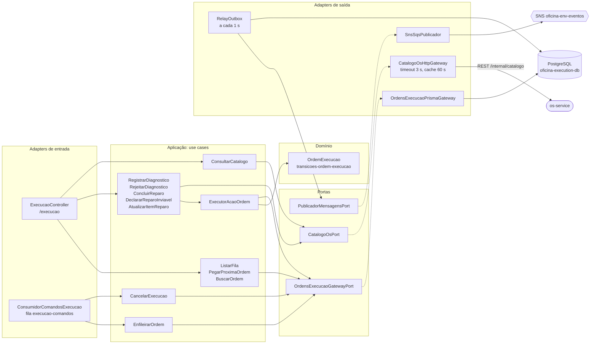
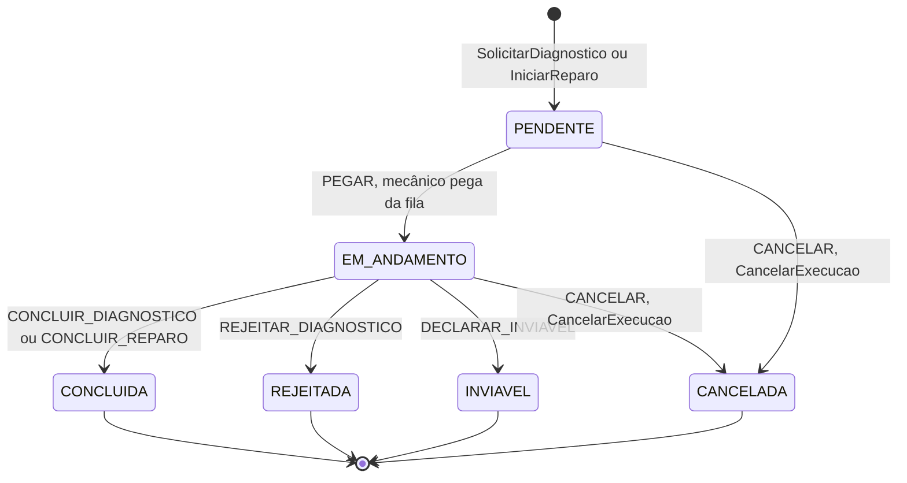
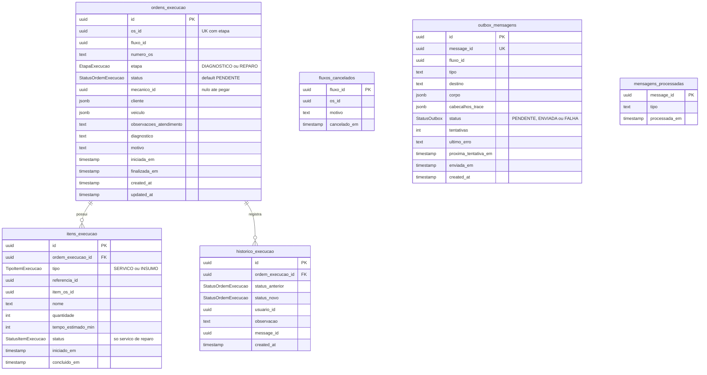

# Arquitetura — execution-service

O execution-service cuida da **execução física** da ordem de serviço: mantém duas filas de trabalho para os mecânicos (diagnóstico e reparo), registra o que cada mecânico fez e informa o resultado ao restante da solução por eventos. É um dos três microsserviços da Fase 4 (os outros são o os-service e o billing-service) e participa do fluxo da OS como **participante**: recebe comandos do orquestrador por SQS, aplica a regra no seu próprio banco (PostgreSQL) e responde com eventos no tópico SNS.

## 1. Responsabilidade

| O execution faz | O execution não faz |
| --- | --- |
| Enfileira uma ordem de diagnóstico (`SolicitarDiagnostico`) e uma de reparo (`IniciarReparo`) por OS | Decidir o rumo da OS: quem coordena os passos é o orquestrador do os-service |
| Entrega a próxima ordem da fila a um mecânico, sem que dois peguem a mesma | Orçar ou cobrar (billing-service) |
| Registra diagnóstico (validando os itens no catálogo do OS), rejeição, conclusão e inviabilidade do reparo | Ser dono do catálogo de serviços e insumos: consulta o os-service por REST |
| Guarda histórico de cada mudança de estado da ordem | Publicar evento sem antes gravá-lo junto do efeito (outbox, seção 8) |
| Cancela a ordem ativa quando o orquestrador compensa, inclusive quando o cancelamento chega antes da criação | |

Rotas, filas e mensagens completas estão em [`contratos/README.md`](../contratos/README.md).

## 2. Componentes (Clean Architecture)

Os *adapters* de entrada (controller HTTP e consumidor SQS) chamam *use cases*; os use cases dependem de **portas** (interfaces); os *adapters* de saída as implementam. A transição de estado e a regra "só o mecânico dono age na ordem" ficam concentradas no `ExecutorAcaoOrdem` e no domínio.



Ligação das portas (`execucao.module.ts:39-44`): `ORDENS_EXECUCAO_GATEWAY` → `OrdensExecucaoPrismaGateway` e `CATALOGO_OS` → `CatalogoOsHttpGateway`, configurado por `OS_SERVICE_URL` e `INTERNAL_API_KEY`.

## 3. Rotas

Todas passam pelo API Gateway com o prefixo `/execucao` e exigem JWT de staff com role `MECANICO` ou `ADMINISTRADOR` (`execucao.controller.ts`, linhas 29-30). Só o mecânico que pegou a ordem (ou um administrador) pode agir nela.

| Rota | Use case |
| --- | --- |
| `GET /execucao/fila?etapa=DIAGNOSTICO\|REPARO` | listar as ordens `PENDENTE` em ordem de chegada |
| `POST /execucao/fila/:etapa/proxima` | reservar a próxima ordem para o mecânico do token (`404` com a fila vazia) |
| `GET /execucao/ordens/:ordemExecucaoId` | detalhe com itens e histórico |
| `POST /execucao/ordens/:ordemExecucaoId/diagnostico` | registrar o diagnóstico (`422` para item fora do catálogo ou repetido, `503` com o OS indisponível) |
| `POST /execucao/ordens/:ordemExecucaoId/diagnostico/rejeitar` | rejeitar o diagnóstico, com motivo |
| `POST /execucao/ordens/:ordemExecucaoId/reparo/concluir` | concluir o reparo |
| `POST /execucao/ordens/:ordemExecucaoId/reparo/inviavel` | declarar o reparo inviável, com motivo |
| `POST /execucao/ordens/:ordemExecucaoId/reparo/itens/:itemId/iniciar` e `.../concluir` | acompanhar cada serviço do reparo (`PENDENTE` → `EM_EXECUCAO` → `CONCLUIDO`) |
| `GET /execucao/catalogo/servicos`, `GET /execucao/catalogo/insumos` | repassar o catálogo do os-service |
| `GET /health` | pública, sem prefixo, probe do Kubernetes |

## 4. Máquina de estados da ordem

Existe uma ordem por par (OS, etapa): `@@unique([osId, etapa])` no schema. As regras estão em `transicoes-ordem-execucao.ts:10-15`; os estados ativos, `PENDENTE` e `EM_ANDAMENTO`, em `ordem-execucao.ts:4`.



Quais ações valem em cada etapa:

| Ação | Etapa | De → para | Evento |
| --- | --- | --- | --- |
| `PEGAR` | diagnóstico e reparo | `PENDENTE` → `EM_ANDAMENTO` | `DiagnosticoIniciado` / `ReparoIniciado` |
| `CONCLUIR_DIAGNOSTICO` | diagnóstico | `EM_ANDAMENTO` → `CONCLUIDA` | `DiagnosticoConcluido` |
| `REJEITAR_DIAGNOSTICO` | diagnóstico | `EM_ANDAMENTO` → `REJEITADA` | `DiagnosticoRejeitado` |
| `CONCLUIR_REPARO` | reparo | `EM_ANDAMENTO` → `CONCLUIDA` | `ReparoConcluido` |
| `DECLARAR_INVIAVEL` | reparo | `EM_ANDAMENTO` → `INVIAVEL` | `ReparoInviavel` |
| `CANCELAR` | diagnóstico e reparo | `PENDENTE` ou `EM_ANDAMENTO` → `CANCELADA` | `ExecucaoCancelada` |

`REJEITADA` só existe para o diagnóstico e `INVIAVEL` só para o reparo. `CANCELADA` não aceita nenhuma ação do mecânico: o `ExecutorAcaoOrdem` responde `422` (`executor-acao-ordem.ts`, `carregarParaAcao`). O `PEGAR` acontece pela rota da fila (`POST /execucao/fila/:etapa/proxima`) e o `CANCELAR` vem do comando `CancelarExecucao`, nunca de uma rota do mecânico.

## 5. Modelo de dados

PostgreSQL próprio (`oficina-execution-db`), acessado com Prisma. O diagrama abaixo é derivado de `prisma/execucao.prisma` e `prisma/mensageria.prisma` (nomes físicos das tabelas pelo `@@map`).



Observações:

- **Relacionamentos.** Itens e histórico pertencem a uma ordem, com `ON DELETE CASCADE`. `fluxos_cancelados`, `outbox_mensagens` e `mensagens_processadas` não têm chave estrangeira: ligam-se às demais por `fluxo_id`/`os_id`/`message_id` lógicos, e cada uma tem uma função de infraestrutura (seções 7 e 8).
- **Índices.** `ordens_execucao` tem `UNIQUE(os_id, etapa)` e índice em `(etapa, status, created_at)`, que serve exatamente à consulta da fila; `outbox_mensagens` tem índice em `(status, proxima_tentativa_em)`.
- **Itens.** No diagnóstico, os itens são o que o mecânico apontou; no reparo, o que foi aprovado e pago. O `status` do item só existe para serviços de ordens de reparo.
- **Histórico.** Cada mudança de estado grava `status_anterior`, `status_novo`, quem agiu e o `message_id` do evento correspondente. A ação de iniciar ou concluir item grava uma linha com os dois status iguais (`EM_ANDAMENTO`).

## 6. A fila com `FOR UPDATE SKIP LOCKED`

A "fila" não é uma fila de mensageria: é a própria tabela `ordens_execucao`, onde cada linha `PENDENTE` é uma ordem esperando um mecânico. O problema clássico é que dois mecânicos chamam `POST /execucao/fila/DIAGNOSTICO/proxima` ao mesmo tempo, leem a mesma "primeira" linha e os dois acham que ela é deles.

`pegarProxima` (`ordens-execucao.prisma.gateway.ts:192-220`) resolve isso numa única transação:

```sql
SELECT id FROM ordens_execucao
WHERE etapa = CAST(:etapa AS "EtapaExecucao") AND status = 'PENDENTE'
ORDER BY created_at, id
LIMIT 1
FOR UPDATE SKIP LOCKED
```

(linhas 194-199 do gateway)

- `FOR UPDATE` trava a linha escolhida até o fim da transação.
- `SKIP LOCKED` faz a segunda transação **pular** as linhas já travadas em vez de esperar por elas: ela recebe a próxima ordem livre, ou nada (`404`, fila vazia) se não houver outra.
- Na mesma transação a ordem vai a `EM_ANDAMENTO`, recebe o `mecanico_id`, ganha a linha de histórico e o evento `DiagnosticoIniciado`/`ReparoIniciado` entra na outbox. Se qualquer passo falhar, nada disso vale.

Resultado: duas chamadas simultâneas nunca recebem a mesma ordem, e ninguém fica bloqueado esperando o outro. A ordem de entrega é a de chegada (`created_at`, desempatada por `id`), a mesma que `GET /execucao/fila` mostra.

As demais ações sobre uma ordem usam o mesmo cuidado com outra forma: `transicionar` (linhas 145-150) faz `SELECT ... FOR UPDATE` na linha da ordem e confere se o status atual ainda está entre os estados de origem permitidos; se outro processo mudou a ordem no meio (por exemplo, um cancelamento do fluxo enquanto o mecânico concluía), lança `TransicaoConcorrenteError` e a rota responde `422`. A leitura da ordem é refeita sob o lock — a contramedida de **reler o valor antes de atualizar** contra a anomalia de *lost update*. O mesmo `SKIP LOCKED` aparece no `RelayOutbox` (seção 8), para réplicas não publicarem a mesma mensagem.

## 7. Cancelamento antecipado

O SQS Standard **não garante ordem**: `CancelarExecucao` pode chegar antes de `SolicitarDiagnostico` ou de `IniciarReparo`, e uma ordem criada depois do cancelamento seria uma ordem órfã na fila dos mecânicos. A tabela `fluxos_cancelados` fecha essa janela.

| Situação | O que o execution faz | Evento |
| --- | --- | --- |
| `CancelarExecucao` com ordem ativa (`PENDENTE` ou `EM_ANDAMENTO`) | Numa transação: ordem → `CANCELADA`, grava `fluxos_cancelados` e histórico (`cancelar-execucao.use-case.ts:21-34`) | `ExecucaoCancelada{etapa}` |
| `CancelarExecucao` sem ordem ativa | Grava `fluxos_cancelados` (`registrarCancelamentoDoFluxo`, `ordens-execucao.prisma.gateway.ts:131-143`) | `ExecucaoCancelada` com a etapa da ordem já cancelada, ou `etapa: null` se nunca houve ordem |
| `SolicitarDiagnostico`/`IniciarReparo` de um fluxo que está em `fluxos_cancelados` | Não cria ordem (`criarOrdem` lança `FluxoCanceladoError`, linha 95) | `ExecucaoCancelada` com `etapa: null` (`enfileirar-ordem.use-case.ts`, `reemitirCancelada`) |
| `CancelarExecucao` repetido (outro `messageId`) | Mesmo caminho: reemite o resultado | `ExecucaoCancelada` |

A corrida entre "criar a ordem" e "registrar o cancelamento" entre réplicas diferentes é resolvida por um **advisory lock** do PostgreSQL por fluxo (`pg_advisory_xact_lock(hashtext(fluxoId))`, `travarFluxo`, linha 52): as duas transações se serializam. Quem chega segundo enxerga o commit do primeiro. Se o cancelamento descobre uma ordem ativa criada em paralelo, ele lança `TransicaoConcorrenteError` (linha 139); a mensagem não é apagada, volta à fila e, na releitura, o caso de uso cancela a ordem ativa. O código documenta que essas transações **não devem subir o isolamento** acima de READ COMMITTED nem mover a conferência para antes do lock.

## 8. Mensagens, idempotência e outbox

Contrato completo (envelope, atributos, catálogo, regras de idempotência e schemas): [`contratos/README.md`](../contratos/README.md).

| Sentido | Canal | Mensagens |
| --- | --- | --- |
| Consome | fila `oficina-<env>-execucao-comandos` (DLQ `-dlq`), aceita só `origem: os` | `SolicitarDiagnostico`, `IniciarReparo`, `CancelarExecucao` (`consumidor-comandos-execucao.ts:42-49`) |
| Produz | tópico SNS `oficina-<env>-eventos`, `origem: execution` | `ExecucaoEnfileirada`, `DiagnosticoIniciado`, `DiagnosticoConcluido`, `DiagnosticoRejeitado`, `ReparoIniciado`, `ReparoConcluido`, `ReparoInviavel`, `ExecucaoCancelada` (`eventos-execucao.ts:3-11`) |

- **Consumo.** Long polling, lote de até 10, validação do envelope contra os schemas do contrato e exclusão da mensagem só depois de o processamento terminar (`consumidor-sqs.ts:100`). Mensagem com origem diferente de `os` é ignorada com aviso (linha 82). Erro de processamento não apaga: a mensagem volta e, na quinta entrega, vai para a DLQ.
- **Idempotência do consumidor.** O `message_id` do comando é inserido em `mensagens_processadas` na mesma transação do efeito, com `createMany ... skipDuplicates` (`registrarMensagem`, linhas 22-29). Reentrega da mesma mensagem gera `MensagemJaProcessadaError`, tratada no consumidor como duplicada, sem efeito nem evento novos (`consumidor-comandos-execucao.ts:31-38`).
- **Reenvio com `messageId` novo.** `SolicitarDiagnostico`/`IniciarReparo` para uma OS+etapa que já tem ordem não cria outra: registra a mensagem e reemite `ExecucaoEnfileirada` com o id da ordem existente, para o orquestrador conseguir avançar (`enfileirar-ordem.use-case.ts:65-70`).
- **Outbox.** O evento é gravado em `outbox_mensagens` na mesma transação do efeito (`gravarOutbox`, junto do trace de observabilidade). O `RelayOutbox` roda a cada 1 s (`relay-outbox.ts:30`) e, em cada rodada, reivindica até 10 linhas `PENDENTE` com `UPDATE ... WHERE id IN (SELECT ... FOR UPDATE SKIP LOCKED)`, avançando `proxima_tentativa_em` em 30 s como *lease* (linhas 20, 46-52); assim réplicas diferentes não publicam a mesma mensagem, e uma linha só é revista se o pod morrer. Falha de envio recalcula `proxima_tentativa_em` com espera exponencial de até 60 s e, na 10ª tentativa, marca a linha como `FALHA` (linhas 71-73).

## 9. REST síncrono ao catálogo do OS

Quase tudo no execution é assíncrono, por mensagens. A exceção deliberada é o **diagnóstico**: quando o mecânico registra os itens apontados, o execution precisa saber **na hora** se cada serviço ou insumo existe e está ativo, porque a resposta ao mecânico (`200` ou `422`) depende disso. Esperar uma resposta por mensageria deixaria a tela do mecânico pendurada, então esse ponto usa uma **API RESTful síncrona**, que é o catálogo do os-service (dono do cadastro).

`CatalogoOsHttpGateway` (`catalogo-os.http.gateway.ts`):

| Aspecto | Comportamento |
| --- | --- |
| Rotas chamadas | `GET /internal/catalogo/servicos` e `GET /internal/catalogo/insumos` em `OS_SERVICE_URL` (URL interna do cluster; não passam pelo API Gateway) |
| Autenticação | header `x-internal-api-key` com `INTERNAL_API_KEY` (linha 56) |
| Timeout | 3 s por chamada (`AbortSignal.timeout`, padrões nas linhas 34 e 57) |
| Cache | em memória, por rota, TTL de 60 s (linha 35); chamada com `ignorarCache` pula o cache |
| Revalidação | se algum item do diagnóstico não aparece no cache, `resolverNoCatalogo` consulta de novo ignorando o cache antes de recusar com `422` (`registrar-diagnostico.use-case.ts:71-86`); assim um insumo recém-cadastrado não é recusado por cache velho |
| Falha | timeout, erro de rede, HTTP diferente de 2xx, `401` (chave interna recusada) ou corpo em formato inesperado viram `503 Service Unavailable` com a causa (linhas 59-70) |

O cache é por réplica (memória do processo). A chave interna vem do SSM `/oficina/<env>/internal-api-key`, e o contrato das rotas internas está em [`contratos/README.md`](../contratos/README.md).

O diagnóstico também recusa com `422` itens repetidos (mesmo `tipo` e `referenciaId`) e itens fora do catálogo ativo (`registrar-diagnostico.use-case.ts:36-41`).

## 10. Papel no fluxo da OS

O fluxo da OS é coordenado por uma **Saga orquestrada** (Saga Pattern): um orquestrador central manda comandos e reage aos eventos de cada serviço, e desfaz o que já foi feito com compensações quando algo falha. No código, a Saga se chama `orquestracao-os`, o estado dela é o `FluxoOrdemServico` e o coordenador é o `OrquestradorOrdemServico`, todos no os-service. O execution é **participante**, sem lógica de orquestração.

| Passo da Saga | Comando que o execution recebe | Eventos que devolve |
| --- | --- | --- |
| Diagnosticar | `SolicitarDiagnostico` | `ExecucaoEnfileirada{etapa:DIAGNOSTICO}` na hora; depois `DiagnosticoIniciado` e `DiagnosticoConcluido` ou `DiagnosticoRejeitado`, conforme o mecânico |
| Reparar | `IniciarReparo` | `ExecucaoEnfileirada{etapa:REPARO}` na hora; depois `ReparoIniciado` e `ReparoConcluido` ou `ReparoInviavel` |
| Compensar: cancelar a execução | `CancelarExecucao` | `ExecucaoCancelada` (também quando não há ordem ativa) |

A confirmação imediata `ExecucaoEnfileirada` é separada do início do trabalho porque a ordem pode ficar na fila por muito tempo: o orquestrador só precisa saber que o comando foi aceito. Ações humanas (pegar, concluir, rejeitar) acontecem por HTTP e viram eventos que o orquestrador consome.

Para o conjunto da solução, ver no os-service a [visão geral](https://github.com/FIAP-POS-TECH-SOFTWARE-ARCHITECTURE/tc-oficina-os-service/blob/main/docs/arquitetura/visao-geral-microsservicos.md), a [sequência do fluxo da OS](https://github.com/FIAP-POS-TECH-SOFTWARE-ARCHITECTURE/tc-oficina-os-service/blob/main/docs/arquitetura/sequencia-fluxo-os.md), a [sequência de compensação](https://github.com/FIAP-POS-TECH-SOFTWARE-ARCHITECTURE/tc-oficina-os-service/blob/main/docs/arquitetura/sequencia-compensacao.md) e a [ADR 008 (Saga orquestrada)](https://github.com/FIAP-POS-TECH-SOFTWARE-ARCHITECTURE/tc-oficina-os-service/blob/main/docs/arquitetura/adrs/adr-008-saga-orquestrada.md).
